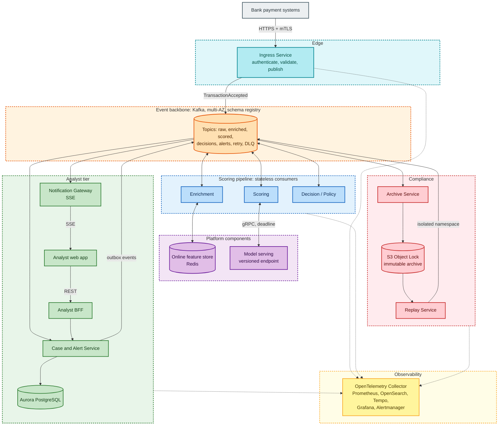
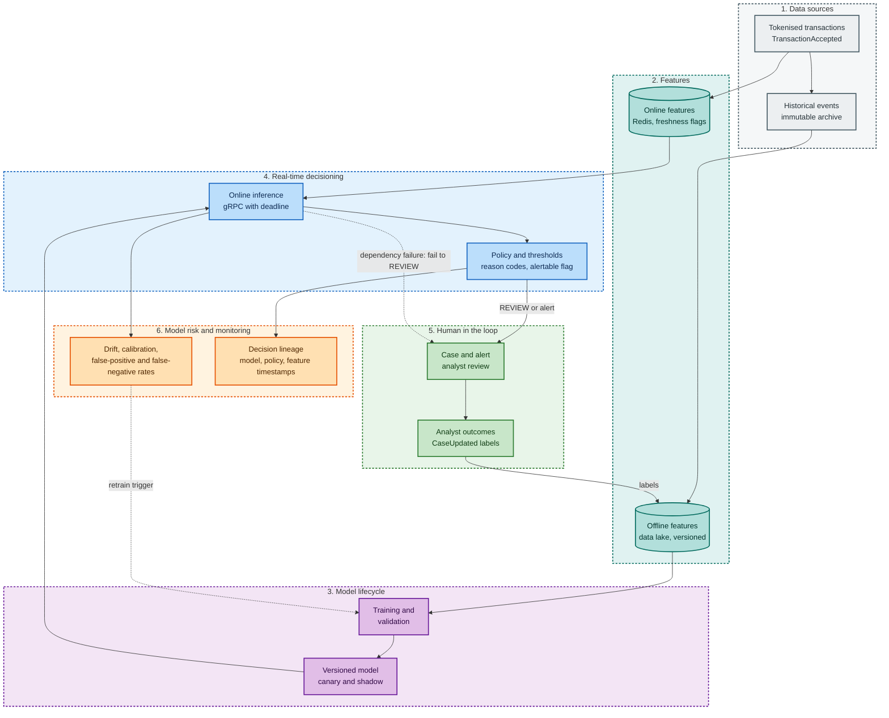

# Real-Time Financial Fraud Detection Platform

**An event-driven, cloud-native solution architecture for detecting card and payment fraud in near real time, with a replayable audit trail and live analyst alerts.**

---

## Table of Contents

1. [Overview](#1-overview)
2. [Project Status and Evidence](#2-project-status-and-evidence)
3. [Requirements and Objectives](#3-requirements-and-objectives)
4. [Architecture](#4-architecture)
   - [4.1 System architecture](#41-system-architecture)
   - [4.2 Data science flow](#42-data-science-flow)
   - [4.3 Colour legend](#43-colour-legend)
   - [4.4 Microservices](#44-microservices)
   - [4.5 Event catalogue](#45-event-catalogue)
   - [4.6 End-to-end transaction flow](#46-end-to-end-transaction-flow)
   - [4.7 Operating modes](#47-operating-modes)
5. [Technology Stack](#5-technology-stack)
6. [Service Level Objectives and Observability](#6-service-level-objectives-and-observability)
7. [Scaling and Capacity](#7-scaling-and-capacity)
8. [Resilience, Replay and Compliance](#8-resilience-replay-and-compliance)
9. [Security and Governance](#9-security-and-governance)
10. [Testing and Results](#10-testing-and-results)
11. [Deliverables in This Project](#11-deliverables-in-this-project)
12. [How to Read These Documents](#12-how-to-read-these-documents)
13. [Roadmap](#13-roadmap)
14. [Known Limitations](#14-known-limitations)
15. [Glossary](#15-glossary)
16. [References](#16-references)
17. [Ownership and Licence](#17-ownership-and-licence)

---

## 1. Overview

Batch fraud controls identify fraud long after money has moved. This project defines a replacement: a **real-time, event-driven platform** that accepts every transaction into a durable log, enriches it with online features, scores it with a versioned machine-learning model, applies policy, and puts alerts in front of fraud analysts within seconds.

The design answers six business requirements:

| # | Requirement | How the design answers it |
|---|---|---|
| 1 | Real-time analysis | Streaming pipeline with online features and inference; p99 target of 300 ms from acceptance to decision |
| 2 | Capture and replay for compliance | Replicated Kafka log, immutable S3 Object Lock archive, isolated and ticketed replay, reconciliation |
| 3 | 1,000 TPS peak | Partitioned log (24 partitions), scaled consumers, sized model-serving tier |
| 4 | Elastic scaling without permanent peak cost | Autoscaling on consumer lag and latency, with a floor, cooldown and slow scale-in |
| 5 | Real-time alerts to analysts | Alert events, Server-Sent Events (SSE) gateway, durable case store as source of truth |
| 6 | Operationalisable | OpenTelemetry, correlated telemetry, seven SLOs, burn-rate alerting, runbooks |

**At a glance**

| Dimension | Summary |
|---|---|
| Services | 9 microservices, each with one trigger and one responsibility |
| Events | 11 versioned event types over Apache Kafka (Amazon MSK) |
| Delivery model | At-least-once with idempotent effects; global exactly-once is deliberately not claimed |
| Failure policy | Fail to human review; never fail open |
| Compliance | Immutable archive, isolated replay, reconciliation job |
| Deployment | AWS multi-AZ, multi-account, secondary region for disaster recovery |

---

## 2. Project Status and Evidence

> **This is a design-stage project. No system has been built, deployed or load tested.** Every latency, availability and capacity figure is a target, a calculation or a model, and is labelled as such.

| Evidence | Result | Type |
|---|---|---|
| Original solution guide vs. 15 review criteria | 7 met, 7 partial, 1 not met | Review |
| Defects found in the original | 8 (1 critical, 2 high, 4 medium, 1 low) | Review |
| Revised design vs. same 15 criteria | 15 of 15 met | Self-assessed |
| Event schema validation tests | 9 of 9 behaved as expected | Executed |
| References checked against live pages | 15 of 15 | Executed |
| Model replicas at 1,000 TPS (Little's law) | 13 steady state, 19 with 50% headroom | Calculated |
| Simulated p99 latency, independent stages | 227.5 ms | Modelled |
| Simulated p99 latency, correlated load | 296.2 ms | Modelled |
| Simulated p99 latency, model slowed 80% | 423.8 ms (target breached) | Modelled |
| Autoscaling saving under an assumed daily profile | 68.3% fewer replica-hours | Modelled |

**Key finding.** The 300 ms budget has almost no margin under correlated load and fails when the model slows significantly. Deadlines, circuit breakers, degraded mode and a documented stage-fusion fallback are therefore essential parts of the design, and measuring real latency is the first job of the proof of concept.

---

## 3. Requirements and Objectives

The brief leaves one question open: **does a payment wait for the fraud verdict?** The answer changes the architecture, so the design supports both outcomes on the same backbone (see [Operating modes](#47-operating-modes)).

**Design principles**

| Principle | Mechanism | Risk addressed |
|---|---|---|
| Durable first | Kafka `acks=all`, replication factor 3, minimum in-sync replicas 2 | Loss of accepted transactions |
| Decoupled services | Versioned events, schema registry, no shared databases | Cascading change and failure |
| Fail safe | Quarantine to `REVIEW` with a degraded-mode flag; circuit breakers | Silent approval during outages |
| Reproducible decisions | Model, policy and feature lineage recorded in every decision | Unexplainable outcomes |
| Isolated workloads | Separate consumer groups, quotas, replicas and replay namespaces | Surges starving live scoring |
| Honest assumptions | Targets labelled as hypotheses and validated by a test plan | False confidence |

---

## 4. Architecture

### 4.1 System architecture

Each colour below marks one node group. Solid arrows are the main data path, and dotted arrows are telemetry.

### 4.2 Data science flow

How data becomes a decision, and how analyst outcomes flow back into the model. This diagram extends the platform concept from the report (accept, enrich, score, decide, alert, learn) with the model lifecycle and monitoring stages.

### 4.3 Colour legend

| Diagram | Colour | Group | Contents |
|---|---|---|---|
| System architecture | Slate | Source | Bank payment systems |
| System architecture | Teal | Edge | Ingress Service |
| System architecture | Orange | Event backbone | Kafka topics, schema registry |
| System architecture | Blue | Scoring pipeline | Enrichment, Scoring, Decision / Policy |
| System architecture | Purple | Platform components | Online feature store, model serving |
| System architecture | Green | Analyst tier | Case and Alert, Aurora, Notification Gateway, BFF, web app |
| System architecture | Red | Compliance | Archive, S3 Object Lock, Replay |
| System architecture | Gold | Observability | OpenTelemetry Collector and backends |
| Data science flow | Slate | 1. Data sources | Transactions, historical archive |
| Data science flow | Teal | 2. Features | Online and offline feature stores |
| Data science flow | Purple | 3. Model lifecycle | Training, validation, versioned model |
| Data science flow | Blue | 4. Real-time decisioning | Inference, policy and thresholds |
| Data science flow | Green | 5. Human in the loop | Case review, analyst labels |
| Data science flow | Orange | 6. Model risk and monitoring | Drift, calibration, decision lineage |

### 4.4 Microservices

Nine loosely coupled services plus two platform components (model serving and the online feature store). Services share event schemas, never databases or code.

| Service | Responsibility | Trigger | Inputs and outputs | Scales on |
|---|---|---|---|---|
| **Ingress** | Authenticate, validate, assign IDs, publish durably | HTTPS request | Transaction in; `TransactionAccepted` or `TransactionRejected` out | Concurrency, p99 |
| **Enrichment** | Attach online features with freshness flags | `TransactionAccepted` | Event and features in; `TransactionEnriched` out | Consumer lag |
| **Scoring** | Call versioned model under a deadline | `TransactionEnriched` | Features in; `ModelScored` out | Lag, in-flight requests |
| **Decision** | Apply versioned thresholds and rules; set `alertable` flag | `ModelScored` | Score in; `DecisionRecorded` out | Consumer lag |
| **Case and Alert** | Persist decision, open case, publish alerts via outbox | `DecisionRecorded`, analyst action | Decision in; `FraudAlertRaised`, `CaseOpened`, `CaseUpdated` out | Lag, DB writes |
| **Notification Gateway** | Push alerts to analysts | Alert and case events | Events in; SSE messages out | Open connections |
| **Analyst BFF** | Aggregate data and authorise analyst actions | HTTPS request | Queries in; JSON and `CaseUpdated` out | Concurrency, p99 |
| **Archive** | Write immutable copies and manifests | Accepted, decision, alert, case events | Events in; S3 objects and manifests out | Consumer lag |
| **Replay** | Re-inject events into an isolated namespace | `ReplayRequested` | Time range and versions in; isolated topics and report out | Rate-limited workers |

### 4.5 Event catalogue

| Event | What and when | Why it exists | Publisher to consumers |
|---|---|---|---|
| `TransactionAccepted` | Valid transaction durably stored | Canonical input and audit start | Ingress to Enrichment, Archive |
| `TransactionRejected` | Authentication or schema failure | Proof input was seen but not scored | Ingress to rejection audit |
| `TransactionEnriched` | Features attached | Separates features from scoring | Enrichment to Scoring |
| `ModelScored` | Inference returned within deadline | Records model version and lineage | Scoring to Decision |
| `DecisionRecorded` | Policy outcome committed | System-of-record decision; basis for Mode B | Decision to Case, Archive, Reporting |
| `FraudAlertRaised` | Case committed with `alertable=true` | Real-time analyst attention | Case (outbox) to Notification, Archive |
| `CaseOpened` | Case created | User interface list update | Case to Notification |
| `CaseUpdated` | Analyst action or state change | Audit, synchronisation, model labels | Case to Notification, Archive |
| `ArchiveManifestWritten` | Archive batch closed | Reconciliation input | Archive to Reconciliation job |
| `ReplayRequested` | Approved bounded replay | Controlled compliance replay | Operations tool to Replay |
| `ProcessingFailed` | Retries exhausted | Prevents silent loss; pages on-call | Pipeline services to DLQ, on-call |

**Event envelope.** Every event carries `event_id`, `event_type`, `schema_version`, `occurred_at`, `transaction_id` (opaque token), `correlation_id`, `partition_key` (tokenised account ID), `data_classification` and a W3C `traceparent`. Schemas live in a registry with compatibility checks in CI.

**Deliberate synchronous interactions.** Producer acknowledgement, feature lookup, model inference, analyst UI queries and the optional Mode B decision query. Each carries a deadline and a containment mechanism.

### 4.6 End-to-end transaction flow

1. The payment system posts a transaction with an idempotency key.
2. **Ingress** authenticates and validates it, then publishes `TransactionAccepted` and acknowledges only after Kafka confirms durable storage (`acks=all`).
3. **Enrichment** fetches features within a 50 ms deadline and publishes `TransactionEnriched`.
4. **Scoring** calls the model endpoint over gRPC with a deadline and publishes `ModelScored`.
5. **Decision** applies the active policy version and publishes `DecisionRecorded`, setting `alertable` when thresholds are crossed.
6. **Case and Alert** writes the case and the outbox record in one database transaction, then publishes `FraudAlertRaised` and `CaseOpened`.
7. The **Notification Gateway** pushes an SSE message containing only an alert ID and summary.
8. The analyst's browser fetches case detail through the **BFF**; sensitive data never travels over the push channel.

**Latency budget (p99 hypothesis, 300 ms total)**

| Stage | Budget |
|---|---|
| Ingress and durable publish | 40 ms |
| Enrichment hop and feature lookup | 70 ms |
| Scoring hop and inference | 120 ms |
| Decision hop and publish | 50 ms |
| Headroom | 20 ms |

If measured hop cost threatens the budget, the documented fallback fuses Enrichment, Scoring and Decision into a single stream job (for example Apache Flink) with the logical stages kept as operators.

### 4.7 Operating modes

| Mode | Behaviour | When to use |
|---|---|---|
| **A: asynchronous detection (default)** | Ingress acknowledges durable acceptance; the decision follows as an event | Maximum resilience; detection and alerting without blocking payments |
| **B: synchronous pre-authorisation (optional)** | The payment switch reads the recorded decision with a hard timeout (for example 250 ms) and a Risk-owned fallback | Payment types where Risk requires a verdict before authorising |

---

## 5. Technology Stack

| Layer | Choice | Trade-off |
|---|---|---|
| Cloud | AWS multi-AZ VPC, IAM, KMS | Provider coupling |
| Ingress | ALB or API Gateway; Java or Go on EKS | Gateway limits at 1,000 TPS to validate |
| Event backbone | Amazon MSK (Kafka) with schema registry | Operational and cost complexity |
| Pipeline | Java or Go consumers; KEDA on lag; Flink as fallback | Per-hop latency |
| Model serving | KServe on EKS or a managed endpoint | Quotas, cold starts |
| Features | Redis (online); data lake (offline) | Staleness, train and serve skew |
| Case store | Aurora PostgreSQL Multi-AZ | Vertical write limit |
| Archive | S3 Object Lock with KMS | Restore time, storage cost |
| Frontend | React, TypeScript, SSE, BFF | BFF must stay logic-free |
| Observability | OpenTelemetry, Prometheus, Grafana, OpenSearch, tracing backend | Cardinality and retention cost |
| Delivery | Terraform, CI, Argo CD | Platform team effort |

**Patterns applied:** event-driven backbone, backend-for-frontend, caching, transactional outbox and idempotent consumers, circuit breaker and bulkhead, optional service mesh (adopted only after a baseline load test because retries can amplify load).

---

## 6. Service Level Objectives and Observability

**Three key metrics:** decision latency (p50, p95, p99), consumer lag and oldest-event age, and processing error rate.

| # | Objective | Metric |
|---|---|---|
| 1 | 99% of valid transactions reach `DecisionRecorded` within 300 ms of acceptance at up to 1,000 TPS | `fraud_decision_latency_seconds` |
| 2 | 99% of `POST /v1/transactions` acknowledged in under 75 ms | `ingress_request_duration_seconds` |
| 3 | 99.95% of valid submissions accepted (non-5xx), 30 days | `ingress_requests_total` |
| 4 | 99% of alertable decisions visible to an analyst within 2 s | `alert_propagation_seconds` |
| 5 | 99% of BFF case list requests complete in under 200 ms | `bff_request_duration_seconds` |
| 6 | Oldest unprocessed event on the raw topic under 1 s in 99.9% of minutes | `kafka_consumer_oldest_event_age_seconds` |
| 7 | 99.99% of events archived within 60 s; reconciliation mismatches zero | `archive_lag_seconds`, `reconciliation_mismatch_total` |

**Correlation.** The W3C `traceparent` travels in the event envelope and Kafka headers, so each consumer span links to its producer span and one transaction forms one trace from ingress to analyst notification. Transaction and account IDs are never metric labels.

**Alerting.** Multiwindow, multi-burn-rate alerts following the Site Reliability Engineering Workbook:

| Severity | Long window | Short window | Burn rate | Budget consumed |
|---|---|---|---|---|
| Page | 1 hour | 5 minutes | 14.4 | 2% |
| Page | 6 hours | 30 minutes | 6 | 5% |
| Ticket | 3 days | 6 hours | 1 | 10% |

---

## 7. Scaling and Capacity

| Component | Mechanism | Signal |
|---|---|---|
| Ingress and BFF | Horizontal pod autoscaler; minimum 3 pods across 3 AZs | Concurrency, CPU, p99 |
| Pipeline consumers | KEDA on consumer lag | Lag, oldest-event age (bounded by partitions) |
| Online model | Autoscaled replicas with warm floor | In-flight requests, p99 |
| Offline analytics | Separate batch cluster on spare capacity | Schedule, queue depth |
| Kafka | More partitions and brokers; tiered storage | Broker CPU, disk, ISR health |
| Feature store | Redis shards and replicas | Memory, operations per second |
| Case database | Read replicas, pooling, partitioned history | Connections, replica lag |

**Sizing (illustrative, to be validated).** 1,000 TPS at about 2 KB is roughly 2 MB/s inbound, so partition parallelism, not bandwidth, is the constraint: 24 partitions on the raw topic. By Little's law, 1,000 TPS with 100 ms inference means about 100 requests in flight; at 8 per replica that is 13 replicas, or 19 with 50% headroom. The design runs a floor of 4 and a ceiling of about 20.

---

## 8. Resilience, Replay and Compliance

| Single point of failure | Mitigation |
|---|---|
| Kafka broker or single AZ | Three AZs, RF 3, minimum ISR 2, idempotent producers |
| One model replica or version | Replicas across AZs; previous version kept warm for rollback |
| One database instance | Aurora Multi-AZ failover; read replicas |
| One notification gateway | Multiple stateless instances; cursor catch-up |
| One telemetry collector | Agent plus HA gateway; independent alert path |
| Single-region recovery plan | Cross-region archive replica; mirrored topics or rebuild; rehearsed failover |

| Data-loss scenario | Restoration |
|---|---|
| Ingress crash before acknowledgement | Producer retry with idempotency key; duplicate suppressed |
| Downstream state lost | Reset consumer offsets and reprocess from the log |
| Whole Kafka cluster lost | Replay service rebuilds topics from the S3 archive within the recovery point |
| Case database lost | Restore snapshot; replay later decisions through the idempotent consumer |
| Archive object loss or tamper | Object Lock, versioning, cross-region replica; checksum manifests expose tampering |

**Degraded mode.** If features are missing or the model is unreachable after bounded retries, the decision becomes `REVIEW` with `degraded_mode=true`, on-call is alerted and the item enters the analyst queue. The platform never approves by default.

**Replay guardrails.** Approved ticket, bounded range, named destination namespace, chosen model and rules version, own consumer group and quota. Replays run only in isolated topics and stores and can never trigger live alerts or payments.

**Audit and year-end surges.** Forecast at 1x, 2x and stress multiples; pre-scale within quotas; isolate live scoring from replay and reporting; throttle replay first; rehearse peak, soak, failover and restore; run a command centre with go or no-go criteria; reconcile afterwards.

---

## 9. Security and Governance

- TLS everywhere, mutual TLS between services, KMS encryption at rest, private subnets and no public broker, database or model endpoints.
- Tokenised identifiers; payloads redacted from logs and traces; protected DLQ and archive access.
- Least privilege with workload identities, secrets manager, MFA, separation of duties and privileged-access logging.
- Versioned and approved datasets, features, models, thresholds and rules; every decision records model version, policy version, feature timestamps and reason codes.
- Drift, calibration and false-positive and false-negative monitoring; human review with documented overrides; analyst outcomes feed retraining labels.
- CI gates for schema compatibility, dependency and security scanning, model evaluation and signed artefacts; canary or shadow releases with rollback.

---

## 10. Testing and Results

**Test programme (planned for the build phase)**

| Layer | Tests | Pass criterion |
|---|---|---|
| Build time | Unit, contract and schema compatibility | No breaking change merged; all rule boundaries pass |
| Integration | Pipeline with Kafka, Redis, database and model stub; end-to-end trace | One connected trace per transaction |
| Non-functional | Load to 1,000 TPS and stress, soak, chaos and failover, replay and restore | SLOs 1, 2, 3 and 6 met; no acknowledged loss; zero reconciliation mismatches |
| Assurance | Security, model-risk validation, analyst acceptance | No raw card data; limits approved by Risk |

**Executed so far.** Nine JSON Schema tests on the `TransactionAccepted` and `DecisionRecorded` events (two valid events accepted; seven invalid events rejected, including a raw card-number field), a scripted latency simulation of 500,000 transactions per scenario, the capacity calculations, rendering of all diagrams, and verification of all references.

**Simulated latency (assumed lognormal stage distributions; milliseconds)**

| Scenario | p50 | p95 | p99 | Within 300 ms |
|---|---|---|---|---|
| A. Independent stages | 138.0 | 195.6 | 227.5 | 99.98% |
| B. Correlated load | 138.3 | 236.7 | 296.2 | 99.09% |
| C. Model slowed by 80% | 188.4 | 333.2 | 423.8 | 91.13% |

These results show internal consistency and where the design is most sensitive. They are not measurements.

---

## 11. Deliverables in This Project

| File | Description |
|---|---|
| `Fraud_Detection_Platform_Report.pdf` | Full report: executive summary through references, 17 figures and 28 tables |
| `fraud_detection_architecture1.pdf` / `.md` | Revised solution architecture guide (v2.0) with 8 rendered diagrams (excluded in this repository) |
| `fraud_detection_architecture.pdf` / `.md` | Condensed 7-page version meeting all requirements |
| `README.md` | This document |

---

## 12. How to Read These Documents

| If you are... | Start with |
|---|---|
| An executive or sponsor | [Overview](#1-overview), [Project Status and Evidence](#2-project-status-and-evidence), report Sections 1 and 8 |
| An architect or reviewer | [Architecture](#4-architecture), report Sections 4 and 9 |
| A fraud or risk owner | [Operating modes](#47-operating-modes), [Security and Governance](#9-security-and-governance), the data science flow |
| An engineer or SRE | [Microservices](#44-microservices), [SLOs](#6-service-level-objectives-and-observability), [Scaling](#7-scaling-and-capacity) |
| An auditor | [Resilience, Replay and Compliance](#8-resilience-replay-and-compliance), report Section 6 |

---

## 13. Roadmap

| Phase | Activity | Exit criterion |
|---|---|---|
| 1. Decide | Choose Mode A or B; agree RTO, RPO and retention | Signed decisions from Risk, Compliance and Operations |
| 2. Prove | Proof of concept: backbone, pipeline, model, load to 1,000 TPS, failover tests | SLOs 1, 2 and 6 met, or stage fusion adopted |
| 3. Validate | Security, model-risk and analyst acceptance testing | Approvals from security, Risk and analyst leads |
| 4. Build and launch | Phased build, canary release, parallel run with the batch system | Benefits review against baselines |
| 5. Operate | Surge rehearsals, drift monitoring, error-budget reviews | Stable SLO performance over two quarters |

---

## 14. Known Limitations

- No built system, load test or production data; all performance figures are targets or models.
- Latency distributions and the daily load profile are assumed, not fitted to data; real tails are likely heavier.
- No fraud model has been evaluated; detection quality, bias and thresholds are outside this work.
- Regulation, RTO and RPO are not interpreted; they need legal and business sign-off.
- The improvement from v1.0 to v2.0 is self-assessed; an independent review is recommended.
- No threat model, cost estimate or migration plan from the existing batch system is included.
- Cloud quotas, prices and managed-service capabilities change and must be confirmed against current provider documentation.

See [Report](Fraud_Detection_Platform_Report.pdf) for the full discussion of the architecture and limitations

---

## 15. Glossary

| Term | Meaning |
|---|---|
| **BFF** | Backend-for-frontend: a backend shaped for one user experience |
| **DLQ** | Dead-letter queue for messages that exhausted retries |
| **ISR** | In-sync replicas of a Kafka partition |
| **KEDA** | Kubernetes event-driven autoscaler |
| **Outbox pattern** | Writing a database change and its event in one transaction, then relaying the event |
| **p99** | 99th percentile: 99% of requests are at or below this value |
| **RPO / RTO** | Recovery point objective / recovery time objective |
| **SLI / SLO** | Service level indicator (a measure) / objective (a target for it) |
| **SSE** | Server-Sent Events: one-way push from server to browser |
| **TPS** | Transactions per second |

---

## 16. References

Each source was checked against the live web on 5 October 2026.

1. Confluent, "Kafka Replication and Committed Messages." <https://docs.confluent.io/kafka/design/replication.html>
2. Confluent, "Kafka Message Delivery Guarantees." <https://docs.confluent.io/kafka/design/delivery-semantics.html>
3. C. Richardson, "Pattern: Transactional outbox," Microservices.io. <https://microservices.io/patterns/data/transactional-outbox>
4. M. Kleppmann, *Designing Data-Intensive Applications*, O'Reilly Media, 2017. <https://martin.kleppmann.com/2017/03/27/designing-data-intensive-applications.html>
5. Apache Kafka, "Producer Configs," Kafka 2.5 documentation. <https://kafka.apache.org/25/configuration/producer-configs/>
6. Amazon Web Services, "Backends for Frontends Pattern," AWS Front-End Web and Mobile Blog. <https://aws.amazon.com/blogs/mobile/backends-for-frontends-pattern/>
7. OpenTelemetry, "Context propagation." <https://opentelemetry.io/docs/concepts/context-propagation/>
8. W3C, "Trace Context," W3C Recommendation, 23 November 2021. <https://www.w3.org/TR/trace-context/>
9. Google, "Chapter 4: Service Level Objectives," *Site Reliability Engineering*, O'Reilly Media, 2016. <https://sre.google/sre-book/service-level-objectives/>
10. S. Thurgood et al., "Chapter 5: Alerting on SLOs," *The Site Reliability Workbook*, O'Reilly Media, 2018. <https://sre.google/workbook/alerting-on-slos/>
11. Amazon Web Services, "What is Amazon MSK?" Amazon MSK Developer Guide. <https://docs.aws.amazon.com/msk/latest/developerguide/what-is-msk.html>
12. KEDA, "Apache Kafka scaler." <https://keda.sh/docs/scalers/apache-kafka/>
13. Amazon Web Services, "Locking objects with Object Lock," Amazon S3 User Guide. <https://docs.aws.amazon.com/AmazonS3/latest/userguide/object-lock.html>
14. J. D. C. Little, "A proof for the queuing formula: L = λW," *Operations Research*, vol. 9, no. 3, pp. 383-387, 1961. <https://doi.org/10.1287/opre.9.3.383>
15. M. Fowler, "Circuit Breaker," martinfowler.com, 6 March 2014. <https://martinfowler.com/bliki/CircuitBreaker.html>

---

## 17. Ownership and Licence

Ownership, licensing and distribution terms have not been specified for this project and are to be confirmed by the sponsoring organisation. Add a license of your choice (e.g. MIT) before publishing.

*Last updated: 5 October 2026 · Version 1.0*
