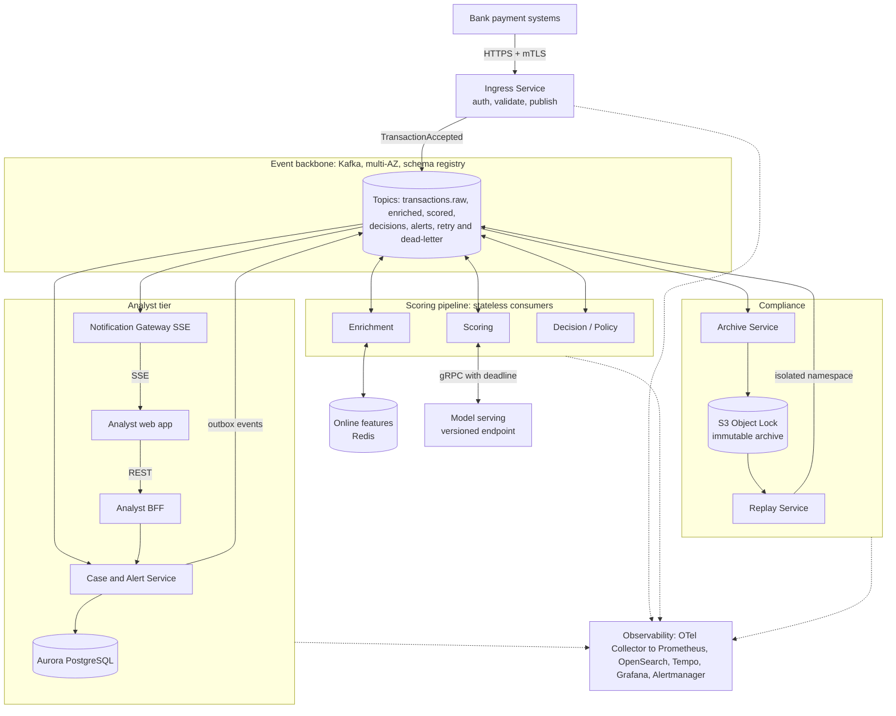
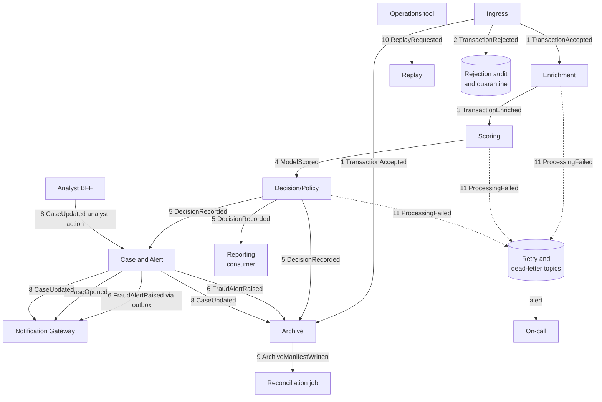
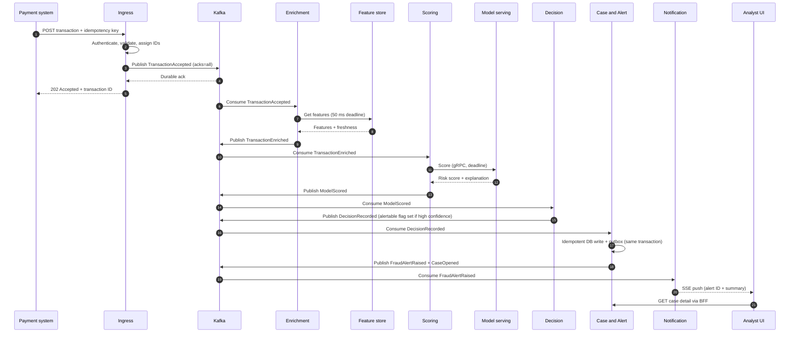
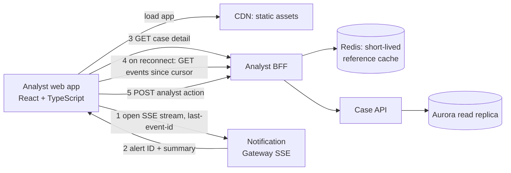
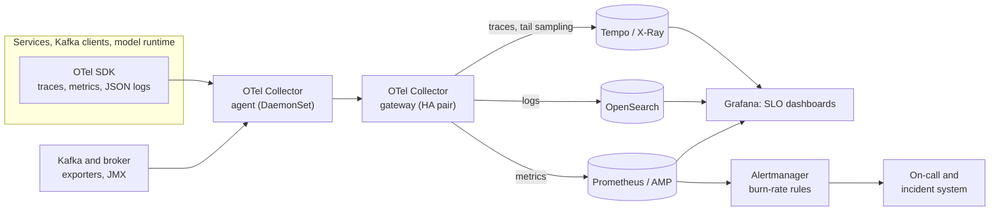

**Version 2.1 · 1 October 2026.** *Design report, not a deployed system. All latency, availability and sizing figures are targets or hypotheses to be validated by load, resilience and model-risk testing; regulatory interpretation must be confirmed by Compliance and Legal.*

# 1. Problem and approach

The batch fraud system is replaced by an **event-driven streaming platform**: every transaction is durably accepted into a replicated Kafka log, enriched, scored by a versioned ML model, passed through policy, and surfaced to analysts in real time. An immutable archive and an isolated replay service meet the compliance requirement.

| Business requirement | Technical objective |
|---|---|
| Real-time analysis | Streaming pipeline with online features and inference; p99 acceptance-to-decision ≤ 300 ms |
| Capture and replay | Durable log + immutable archive + reconciliation + isolated replay |
| 1,000 TPS peak | Partitioned log, horizontally scaled consumers, sized model tier (Section 8) |
| Elastic scaling, no permanent peak cost | Autoscaling on lag/latency with floor, cooldown and slow scale-in |
| Real-time analyst alerts | Alert events → SSE gateway → UI; durable case store is the source of truth |
| Operationalisable | Correlated telemetry, SLOs, burn-rate alerts, runbooks |

**Key decision: does a payment wait for the verdict?** *Mode A (default):* asynchronous detection; ingress acknowledges durable acceptance and the decision follows as an event. *Mode B (optional):* the payment switch queries the recorded decision with a hard timeout (e.g. 250 ms) and a Risk-owned fallback. This is a deliberate synchronous deviation (Section 3.3).

**Assumptions:** ~2 KB per transaction; average load 150–300 TPS with peaks to 1,000; identifiers tokenised before entering the platform; AWS deployment; model team supplies a model with ~100 ms p99 inference.

# 2. Solution architecture and microservices


| Service | Responsibility | Trigger | Inputs → Outputs | Scales on |
|---|---|---|---|---|
| **Ingress** | Authenticate, validate, assign IDs, publish durably | HTTPS request | Transaction + idempotency key → `TransactionAccepted` / `TransactionRejected` | Concurrency, p99 |
| **Enrichment** | Attach online features with freshness flags | `TransactionAccepted` | Event + feature lookups → `TransactionEnriched` | Consumer lag |
| **Scoring** | Call versioned model with deadline | `TransactionEnriched` | Features → `ModelScored` | Lag, in-flight requests |
| **Decision/Policy** | Apply versioned thresholds and rules; set `alertable` flag | `ModelScored` | Score → `DecisionRecorded` | Consumer lag |
| **Case and Alert** | Idempotently persist decision, open case, publish alert via outbox | `DecisionRecorded`; analyst actions | Decision → case rows, `FraudAlertRaised`, `CaseOpened`, `CaseUpdated` | Lag, DB writes |
| **Notification Gateway** | Push alerts to connected analysts | `FraudAlertRaised`, `CaseOpened`, `CaseUpdated` | Events → SSE messages | Open connections |
| **Analyst BFF** | Aggregate case data for the UI; authorise actions | HTTPS request | Queries/actions → JSON; `CaseUpdated` | Concurrency, p99 |
| **Archive** | Write immutable copies and manifests | `TransactionAccepted`, `DecisionRecorded`, `FraudAlertRaised`, `CaseUpdated` | Events → S3 objects, `ArchiveManifestWritten` | Consumer lag |
| **Replay** | Re-inject events into an isolated namespace | `ReplayRequested` (approved ticket) | Time range, model/rules version → isolated topics, replay report | Rate-limited workers |

**Coupling.** Transaction processing uses asynchronous, versioned events only: services share schemas, never databases or code. A slow UI, archive or case database therefore cannot slow scoring. Cost: eventual consistency and harder debugging, addressed by correlation IDs and tracing (Section 6).




# 3. Event-driven design




## 3.1 Event catalogue

| Event | What / when | Why | Publisher → Consumers |
|---|---|---|---|
| `TransactionAccepted` | Valid transaction durably stored (`acks=all`) | Canonical input; audit start | Ingress → Enrichment, Archive |
| `TransactionRejected` | Auth/schema validation failed | Proof input was seen but not scored | Ingress → Rejection audit |
| `TransactionEnriched` | Features attached | Separates features from scoring | Enrichment → Scoring |
| `ModelScored` | Inference returned in deadline | Records model version and lineage | Scoring → Decision |
| `DecisionRecorded` | Policy outcome committed | System-of-record decision; basis for Mode B | Decision → Case, Archive, Reporting |
| `FraudAlertRaised` | Case committed with `alertable=true` | Real-time analyst attention | Case (outbox) → Notification, Archive |
| `CaseOpened` | Case created | UI list update | Case → Notification |
| `CaseUpdated` | Analyst action or state change | Audit, multi-analyst sync, model labels | Case → Notification, Archive |
| `ArchiveManifestWritten` | Archive batch closed | Reconciliation input | Archive → Reconciliation job |
| `ReplayRequested` | Approved bounded replay | Controlled compliance replay | Operations tool → Replay |
| `ProcessingFailed` | Retries exhausted | Prevents silent loss; pages on-call | Enrichment, Scoring, Decision → DLQ, On-call |

## 3.2 Schemas

```json
{ "event_id": "uuid", "event_type": "TransactionAccepted", "schema_version": 1,
  "occurred_at": "2026-10-01T18:00:00Z", "transaction_id": "opaque-token",
  "correlation_id": "uuid", "producer": "ingress-service",
  "partition_key": "tokenised-account-id", "traceparent": "00-<trace>-<span>-01",
  "payload": { "amount": 125.40, "currency": "CAD", "merchant_id": "opaque", "channel": "card" } }
```
```json
{ "event_id": "uuid", "event_type": "DecisionRecorded", "schema_version": 1,
  "transaction_id": "opaque-token", "decision_id": "uuid", "decision": "REVIEW",
  "alertable": true, "risk_score": 0.982, "model_version": "2026.09.3",
  "policy_version": "policy-2026-09", "reason_codes": ["VELOCITY_ANOMALY"],
  "degraded_mode": false, "correlation_id": "uuid", "traceparent": "00-..." }
```

Avro/Protobuf with a schema registry; backward-compatible changes only. Delivery is **at-least-once with idempotent effects** (unique `event_id`/`decision_id`, consumer dedup, outbox); global exactly-once is not claimed. Partition key is a tokenised account ID, preserving per-account ordering for velocity features.

## 3.3 Deviations from event-driven design

| Synchronous interaction | Reason | Mitigation |
|---|---|---|
| Producer → Ingress ack | Payment system needs confirmation of capture | Ack only after `acks=all`; idempotency key; quotas |
| Enrichment → feature store | Must fit latency budget | 50 ms deadline, replicated Redis, freshness flag |
| Scoring → model serving | Inference is request/response | gRPC deadline, circuit breaker, warm replicas, quarantine on failure |
| UI → BFF → Case API | Analysts need immediate answers | Cached reads, replicas; outside scoring path |
| Mode B decision query (optional) | Payment needs verdict pre-authorisation | Hard timeout; Risk-approved fallback |

# 4. End-to-end transaction flow




**Latency budget (hypothesis, p99 300 ms):** ingress and durable publish 40; enrichment hop and features 70; scoring hop and inference 120; decision hop and publish 50; headroom 20. If per-hop Kafka cost threatens the budget, fuse Enrichment, Scoring and Decision into one stream job (e.g. Flink) with logical stages kept as operators, trading independent scaling for latency.


# 5. Frontend




The **BFF** returns one aggregated response per screen and is the single point of analyst authorisation (OIDC, MFA, role/attribute-based, case-level). **SSE** pushes only alert IDs and summaries; details are fetched on demand. For responsiveness: cursor pagination, server-side filtering, virtualised tables, priority-ordered queues, cached non-sensitive reference data, CDN-served assets. On reconnect the UI resumes from its last cursor and backfills via the API, so the **case store, not the socket, is the source of truth**. All analyst actions are audited.

# 6. Observability




**Collection.** Services emit OpenTelemetry metrics, traces and structured JSON logs; a per-node collector agent forwards to an HA gateway pair that routes metrics to Prometheus, logs to OpenSearch and traces to Tempo (tail sampling keeps all error/slow traces). Kafka, Redis and brokers are scraped via exporters. Payloads are redacted from logs.

**Correlation.** The W3C `traceparent` travels in the event envelope and Kafka headers, so each consumer span *links* to its producer and one transaction forms one trace from ingress to UI. Every log line and span carries `trace_id`, `span_id`, `correlation_id`, `event_id`, service and version; latency histograms carry trace *exemplars*. Transaction and account IDs are never metric labels.

**Three key metrics:** (1) **decision latency** p50/p95/p99, the legal real-time requirement; (2) **consumer lag / oldest-event age**, the earliest overload signal and scaling trigger; (3) **processing error rate** (timeouts, retries, DLQ), since silent failure is a compliance breach.

| # | SLO | Metric |
|---|---|---|
| 1 | 99% of valid transactions get a `DecisionRecorded` within **300 ms** of acceptance at up to 1,000 TPS | `fraud_decision_latency_seconds` |
| 2 | 99% of `POST /v1/transactions` acknowledged in **under 75 ms** | `ingress_request_duration_seconds` |
| 3 | 99.95% of valid submissions accepted (non-5xx) over 30 days | `ingress_requests_total` |
| 4 | 99% of alertable decisions visible to an analyst within **2 s** of `DecisionRecorded` | `alert_propagation_seconds` |
| 5 | 99% of BFF `GET /api/cases` complete in **under 200 ms** | `bff_request_duration_seconds` |
| 6 | Oldest unprocessed event on `transactions.raw` **under 1 s** in 99.9% of 1-minute intervals | `kafka_consumer_oldest_event_age_seconds` |
| 7 | 99.99% of accepted events archived within **60 s**; reconciliation mismatches = **0** | `archive_lag_seconds`, `reconciliation_mismatch_total` |

**Alerting:** multi-window error-budget burn-rate pages on SLOs 1, 3, 4; direct pages for DLQ > 0 on critical events, under-replicated partitions, archive age past the recovery point, lag age > 2 s for 3 minutes. Alerts are symptom-based with runbooks.

# 7. Technology stack

| Layer | Choice | Justification / trade-off |
|---|---|---|
| Cloud | AWS multi-AZ VPC, IAM, KMS | Mature managed services; provider coupling |
| Ingress | ALB/API Gateway + Go/Java on EKS | Stateless, predictable latency; validate gateway limits at 1,000 TPS |
| Event backbone | Amazon MSK (Kafka) + Schema Registry | Partitioned, durable, replayable; operational cost (queues lack replay) |
| Pipeline | Java/Go consumers, KEDA on lag; Flink as fallback | Independent scaling; per-hop latency |
| Model serving | KServe on EKS or SageMaker | Versioned, canary-capable; quotas, cold starts |
| Features | Redis (ElastiCache) online; data lake offline | Fast reads; staleness and train/serve skew |
| Case store | Aurora PostgreSQL Multi-AZ | Constraints and transactions; vertical write limit |
| Archive | S3 Object Lock + KMS | WORM retention, durability; restore time |
| Frontend | React/TypeScript, SSE, BFF in Java/Go | Responsive; BFF must stay logic-free |
| Observability | OpenTelemetry, Prometheus/AMP, Grafana, OpenSearch, Tempo, PagerDuty | Vendor-neutral; cardinality cost |
| Delivery | Terraform, GitHub Actions, Argo CD | Repeatable, auditable change |

## Patterns and their contribution

| Pattern | Scalability / resilience | Security / observability | Cost and control |
|---|---|---|---|
| **Event-driven** | Bursts buffered; outages lose nothing; replay | Every stage leaves an auditable event | Eventual consistency; idempotency, registry, tracing |
| **Service mesh** (optional) | Uniform timeouts, circuit breaking | mTLS, workload identity, uniform spans | Latency, retry amplification; retry budgets, HTTP/gRPC only |
| **BFF** | One call per screen; caching near UI | Single authorisation point | Logic creep; keep it rule-free and off scoring path |
| **Caching** (Redis) | Low-latency features; shields DB | Freshness flag exposes staleness | Stale features; TTL, stampede protection, fallback |
| **Outbox/inbox, circuit breaker** | Atomic DB+event; contained failures | Traceable retries | Extra table/relay; tune thresholds |

# 8. Scaling and capacity

| Component | Mechanism | Signal |
|---|---|---|
| **Microservices**: Ingress, BFF | HPA, min 3 pods across 3 AZs, per-producer quotas | Concurrency, CPU, p99 |
| **Microservices**: pipeline consumers | KEDA; scale out fast, in slowly | Lag, oldest-event age (bounded by partitions) |
| **Analytic workloads**: online model | Autoscaled replicas, warm floor, canary/shadow | In-flight requests, p99 |
| **Analytic workloads**: training, backfill, reports | Separate batch cluster / spot, isolated from live | Schedule |
| **Event messaging**: Kafka | Add partitions/brokers; tiered storage | Broker CPU/disk, ISR health |
| Feature store / DB | Redis shards; read replicas, pooling | Memory, replica lag |

**Illustrative sizing (to validate):** 1,000 TPS × 2 KB = 2 MB/s inbound, so partition parallelism, not bandwidth, is the constraint: 24 partitions on `transactions.raw`. By Little's law model concurrency ≈ 1,000 × 0.1 s = 100 in-flight; at 8 per replica ≈ 13 replicas, so run a floor of 4 and scale to ~20. Floors (not zero) keep latency stable; with 150–300 TPS average, steady cost is near the floor.

# 9. Resilience

| Single point of failure | Mitigation |
|---|---|
| Broker / single AZ | RF=3 across AZs, `min.insync.replicas=2`, idempotent producers |
| One model replica / version | Replicas across AZs; previous version warm for rollback |
| One database instance | Aurora Multi-AZ failover, read replicas |
| One notification gateway | Multiple stateless instances; UI cursor catch-up |
| One telemetry collector | Agent + HA gateway; independent alert path for monitoring itself |
| Schema registry, KMS, network route | Replicated deployment, client schema cache, multi-AZ endpoints, break-glass access |
| Single-region recovery | Cross-region archive replication, mirrored topics or archive rebuild, rehearsed failover |

| Data-loss scenario | Where data survives → restoration |
|---|---|
| Ingress crash before ack | Producer retries with idempotency key; duplicate suppressed |
| Downstream service state lost | `transactions.raw` / `decisions` logs → reset offsets, reprocess |
| Whole Kafka cluster lost | S3 archive → Replay service rebuilds topics within RPO |
| Case database lost | Aurora PITR + `decisions`/`alerts` topics and archive → replay after snapshot through idempotent consumer |
| Archive object loss or tamper | Object Lock, versioning, cross-region replica; checksum manifests expose tampering |

**Dependency failure handling.** Model or feature failure never silently approves: after bounded retries the decision is `REVIEW` with `degraded_mode=true`, on-call is alerted, and the item goes to the analyst queue. Poison messages go to retry then DLQ with a protected payload. **Replay** runs only in isolated topics/stores with an approved ticket, bounded range, rate limit and its own consumer group, never triggering live alerts or payments; **reconciliation** compares accepted IDs, offsets, archive manifests, decisions and cases and alerts on mismatch. RTO/RPO are set with business owners; zero loss is not claimed without tested configuration.

# 10. Standout topics

**Deployment on AWS.** Separate accounts for production, non-production, security/log-archive and platform. Multi-AZ VPC with private subnets and PrivateLink; MSK across three AZs; EKS for services and KServe; Aurora Multi-AZ; ElastiCache; S3 Object Lock in the log-archive account with cross-region replication. Adaptations: check MSK broker/partition quotas and **cross-AZ transfer cost** (follower fetching), EKS pod disruption budgets and topology spread, IRSA workload identity, SageMaker/KServe quotas and cold starts, and that Object Lock is set at bucket creation (compliance mode retention cannot be shortened).

**Audit and year-end surge.** Proactively: (1) model load at 1×, 2× and stress multiples from prior audit/year-end profiles including replay and query bursts; (2) pre-scale brokers, workers, model replicas and DB connections ahead of known windows within provider quotas; (3) isolate live scoring from replay, reporting and analyst queries with separate consumer groups, quotas and dedicated replicas or clusters; (4) throttle or pause replay and reporting first, keeping live topics protected; (5) set cost guardrails and reserved floor capacity; (6) rehearse peak, soak, failover, replay and restore before each event; (7) freeze releases and staff a command centre with runbooks and go/no-go criteria; (8) reconcile and scale down gradually afterward.

# 11. Critical evaluation

| Decision | Benefit | Cost / risk | Control |
|---|---|---|---|
| Kafka backbone | Burst buffering, replay, audit trail | Operational complexity, lag | Managed service, SLOs, runbooks |
| Asynchronous decisions | Fault isolation, independent scaling | Cannot block a payment by itself | Mode B with hard timeout where Risk requires |
| Service per stage | Independent scaling and ownership | Per-hop latency, debugging | Latency budget, Flink fallback, tracing |
| Immutable archive | Audit evidence, controlled replay | Storage cost, privacy/retention duties | Lifecycle rules, legal-hold process |
| Separate model service | Independent deploy, rollback | Network hop, availability dependency | Deadlines, warm capacity, quarantine |
| Online feature cache | Low latency | Staleness, skew | TTL, timestamps, parity tests |
| Service mesh | Uniform mTLS and telemetry | Latency, retry amplification | Optional; retry budgets |
| At-least-once + idempotency | Simple, no loss | Duplicate-handling logic | Unique IDs and constraints |
| Fail to *review*, not fail open | No silent approval of risk | Analyst load, customer friction in outages | Review-queue capacity planning |

**Financial-services risks:** model risk (drift, bias, explainability), operational resilience impact tolerances, data protection (tokenisation reduces PCI scope), end-to-end auditability, and single-provider concentration. Each is mitigated by the controls above and must be confirmed with the bank's risk, compliance and security owners.
